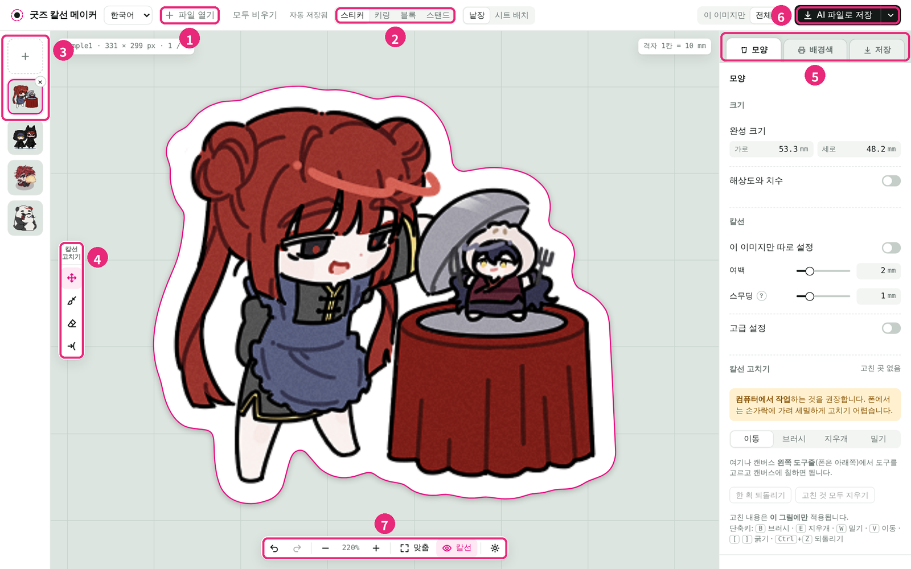

# diecut-studio

그림 파일을 넣으면 스티커·아크릴 굿즈용 칼선을 만들어 주는 웹 도구입니다.
설치 없이 브라우저에서 쓰고, 그림은 서버에 올라가지 않습니다.

지원 언어: 한국어 · English · 日本語 · 中文

샘플 그림 © 버롤 ([X @dessert_jusio](https://x.com/dessert_jusio))

📖 **[사용 가이드 (스크린샷 포함)](docs/GUIDE.md)**

## 사용 방법

1. 만들 제품을 고릅니다. (스티커 / 아크릴 키링 / 아크릴 블록 / 아크릴 스탠드)
2. 그림 파일을 엽니다. 여러 장을 한 번에 열어도 됩니다.
3. 칼선 여백과 모양을 다듬습니다.
4. 아크릴 제품은 3D로 완성 모습을 확인합니다.
5. AI 파일이나 PDF로 저장해 업체에 보냅니다.

자세한 방법은 [사용 가이드](docs/GUIDE.md)를 보세요.

## 제품별 기능

**스티커**
- 칼선 자동 생성
- 배경색 (단색 · 그라데이션)
- 여러 조각을 한 장에 배치 (시트)

**아크릴 키링**
- 고리 구멍
- 여러 개를 줄줄이 잇기
- 3D 미리보기 (이중링 · D고리 · 볼체인 · 오링)

**아크릴 블록**
- 네모 · 타원 · 원 외곽
- 여러 판을 겹치는 레이어
- 3D 미리보기

**아크릴 스탠드**
- 꽂이와 발판 홈 자동 생성
- 발판 모양 · 글자
- 3D 미리보기

**공통**
- 브러시 · 지우개로 칼선 직접 수정
- 화이트 인쇄 레이어, 뒷면 인쇄 (아크릴)
- 3D 화면을 사진 · 4방향 사진 · 회전 영상(MP4)으로 저장
- 자동 저장, 되돌리기

## 파일 형식

| | 형식 |
|---|---|
| 열기 | PNG, WebP, JPG, GIF |
| 저장 | AI, PDF, SVG, PNG(ZIP) |

배경이 투명한 PNG·WebP를 권장합니다. 배경이 있는 그림은 칼선이 사각형으로 나옵니다.

## 실행

- 웹: https://eon-00.github.io/diecut-studio/ (브라우저 언어에 맞춰 열리고, 화면 위에서 언어를 바꿀 수 있습니다)
- 직접 실행: `index.html`을 내려받아 브라우저로 엽니다.

## 참고

- 업체마다 칼선·화이트 규격이 다릅니다. 주문 전에 업체 안내를 확인하세요.
- 3D 미리보기에 [three.js](https://threejs.org/), PDF 저장에 [pdf-lib](https://pdf-lib.js.org/)를 사용합니다.
- Adobe, Illustrator는 Adobe Inc.의 상표입니다.
- AI 바이브 코딩으로 만들었습니다.
- 화면 사진과 가이드 속 샘플 그림 © 버롤 ([X @dessert_jusio](https://x.com/dessert_jusio)) · 작가의 허락을 받아 사용했으며 무단 사용 · 저장 · 재배포를 금지합니다
