# diecut-studio 사용 가이드

그림 파일을 넣으면 스티커·아크릴 굿즈용 칼선을 만들어 주는 웹 도구입니다.
설치 없이 브라우저에서 바로 씁니다. → https://eon-00.github.io/diecut-studio/

> 칼선 고치기처럼 세밀한 작업은 **컴퓨터에서 작업**하는 것을 권장합니다.

가이드의 샘플 그림 © EON · 무단 사용 및 재배포 금지

**목차**
1. [시작하기](#1-시작하기)
2. [화면 둘러보기](#2-화면-둘러보기)
3. [칼선 다듬기](#3-칼선-다듬기)
4. [스티커](#4-스티커)
5. [아크릴 키링](#5-아크릴-키링)
6. [아크릴 블록](#6-아크릴-블록)
7. [아크릴 스탠드](#7-아크릴-스탠드)
8. [화이트 인쇄와 뒷면](#8-화이트-인쇄와-뒷면)
9. [3D 미리보기](#9-3d-미리보기)
10. [저장하기](#10-저장하기)
11. [자주 묻는 것](#11-자주-묻는-것)

---

## 1. 시작하기

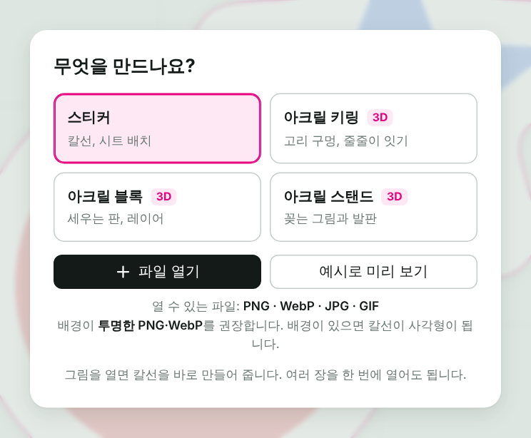

1. **무엇을 만드나요?**에서 제품을 고릅니다.
2. **파일 열기**로 그림을 엽니다. 여러 장을 한 번에 골라도 됩니다.
3. 그림이 없으면 **예시로 미리 보기**로 먼저 둘러볼 수 있습니다.

- 열 수 있는 파일: **PNG · WebP · JPG · GIF**
- **배경이 투명한 PNG·WebP**를 권장합니다. 배경이 있는 그림은 칼선이 사각형으로 나옵니다.
- 화면에 파일을 끌어다 놓아도 열립니다.

---

## 2. 화면 둘러보기

| 번호 | 이름 | 하는 일 |
|:-:|---|---|
| 1 | 파일 열기 | 그림을 더 엽니다 |
| 2 | 제품 | 스티커 · 키링 · 블록 · 스탠드를 바꿉니다 |
| 3 | 이미지 목록 | 연 그림들. 눌러서 고르고, 끌어서 순서를 바꿉니다 |
| 4 | 칼선 고치기 도구줄 | 이동 · 브러시 · 지우개 · 밀기 |
| 5 | 설정 탭 | 모양 · 제품 · 레이어 · 화이트 인쇄 · 3D · 저장 (제품마다 다름) |
| 6 | 저장 버튼 | 오른쪽 ⌄에서 형식을 고릅니다 |
| 7 | 보기 도구줄 | 되돌리기, 확대·축소, 맞춤, 칼선 보기, 3D, ⚙ 화면 설정 |

- 작업 내용은 브라우저에 **자동 저장**됩니다. 창을 닫았다 열어도 이어서 할 수 있습니다.
- 설정 이름 옆 **?** 를 누르면 설명이 나옵니다. ⚙ 화면 설정에서 **설명 모두 보기**를 켜면 항상 보입니다.

---

## 3. 칼선 다듬기

**모양** 탭에서 칼선의 기본 모양을 정합니다.

1. **완성 크기**: 가로나 세로를 mm로 넣으면 그 크기로 맞춰집니다.
2. **여백**: 그림 가장자리에서 칼선까지의 거리입니다.
3. **스무딩**: 칼선을 얼마나 매끈하게 할지 정합니다.
4. 더 세밀하게 바꾸려면 **고급 설정**을 켭니다.

여러 장을 열면 기본으로 **모든 그림에 같은 값**이 적용됩니다.
한 장만 다르게 하려면 **이 이미지만 따로 설정**을 켭니다.

### 칼선 직접 고치기

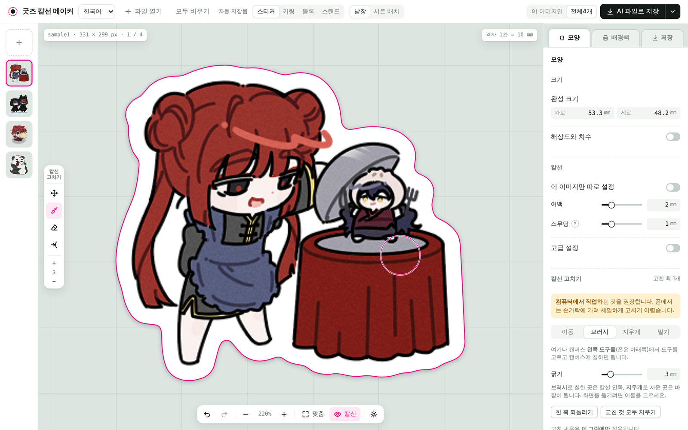

캔버스 왼쪽 **칼선 고치기** 도구줄이나 모양 탭에서 도구를 고르고 캔버스에 칠합니다.

| 도구 | 단축키 | 하는 일 |
|---|:-:|---|
| 이동 | `V` | 화면 옮기기 |
| 브러시 | `B` | 칠한 곳이 칼선 **안쪽**이 됩니다 |
| 지우개 | `E` | 지운 곳이 칼선 **바깥**이 됩니다 |
| 밀기 | `W` | 칼선을 잡고 끌어 모양을 다듬습니다 |

- 굵기는 도구줄의 **+ / −** 나 `[` `]` 로 바꿉니다.
- 고친 내용은 **그 그림에만** 적용됩니다.
- `Space`를 누르고 있는 동안 칼선을 잠깐 숨깁니다.

---

## 4. 스티커

### 배경색

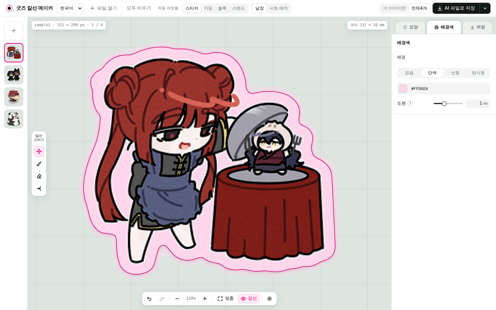

**배경색** 탭에서 칼선 안쪽 여백을 색으로 채웁니다.

1. **단색 · 선형 · 방사형** 중에서 고릅니다.
2. 색을 고르고, 그라데이션이면 방향이나 범위를 맞춥니다.
3. **도련**: 재단이 조금 밀려도 흰 틈이 보이지 않게 배경을 칼선 밖으로 더 칠합니다.

### 시트 배치

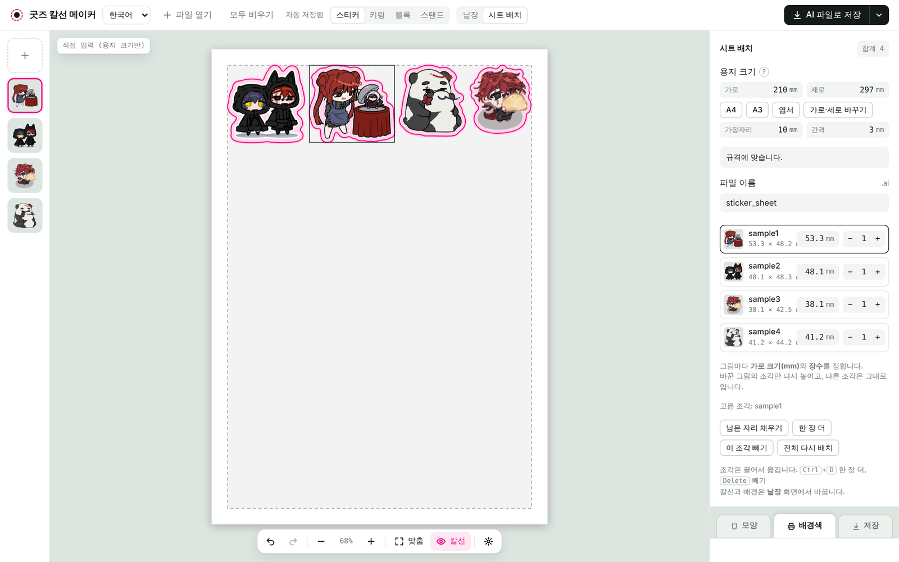

여러 스티커를 한 장의 용지에 배치합니다.

1. 화면 위쪽에서 **시트 배치**를 누릅니다.
2. **용지 크기**를 고릅니다. (A4 · A3 · 엽서 · 직접 입력)
3. 그림마다 **가로 크기**와 **장수**를 정합니다.
4. 조각은 끌어서 옮길 수 있습니다. **남은 자리 채우기**로 빈 곳을 채웁니다.

---

## 5. 아크릴 키링

### 고리 구멍

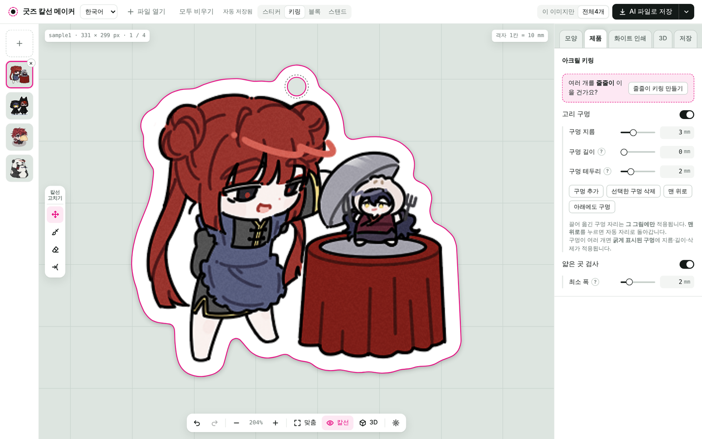

**제품** 탭에서 고리 구멍을 설정합니다.

1. 구멍은 그림 **맨 위에 자동으로** 놓입니다.
2. 캔버스에서 구멍을 **끌어 옮길** 수 있습니다. 옮긴 자리는 그 그림에만 적용됩니다.
3. **구멍 지름 · 길이 · 테두리**로 크기를 바꿉니다. 길이를 늘리면 스트랩용 긴 구멍이 됩니다.
4. **맨 위로**를 누르면 자동 자리로 돌아갑니다.

### 줄줄이 키링 만들기

아크릴 여러 개를 오링으로 이어 다는 키링입니다.
**제품** 탭 맨 위 **줄줄이 키링 만들기**를 누르면 세 단계로 맞출 수 있습니다.

| 1. 그림 순서 | 2. 고리 |
|:-:|:-:|
| 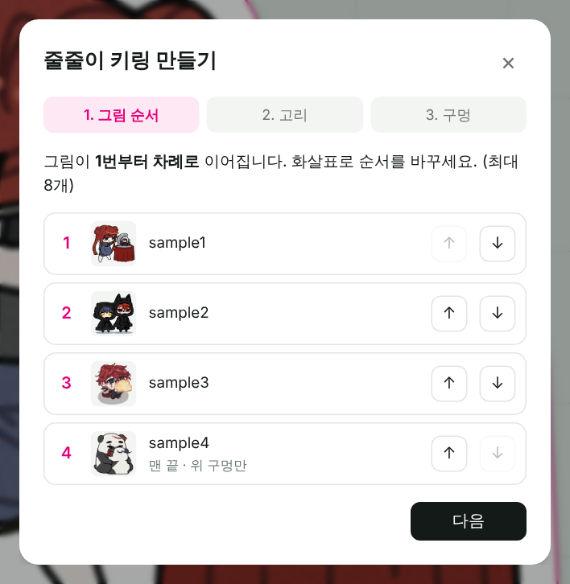 | 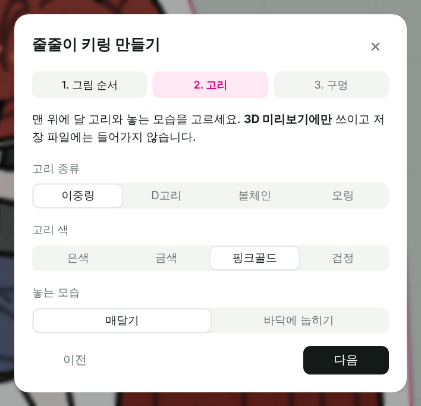 |

1. **그림 순서**: 1번부터 차례로 이어집니다. 화살표로 순서를 바꿉니다. (최대 8개)
2. **고리**: 맨 위에 달 고리 종류와 색, 놓는 모습을 고릅니다.
3. **구멍**: 맨 끝 그림을 빼고 **아래 구멍을 자동으로** 뚫습니다.

> 아래 구멍은 3D만이 아니라 **저장 파일의 칼선에도** 들어갑니다.

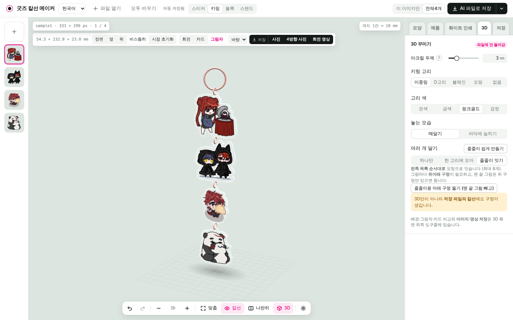

### 바닥에 눕혀 보기

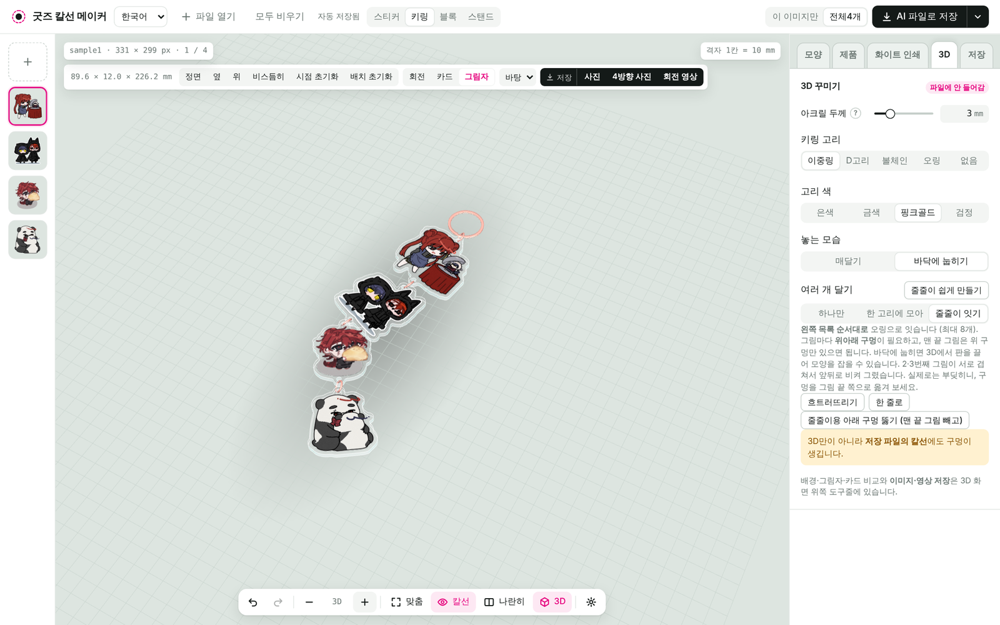

**3D** 탭 **놓는 모습**에서 **바닥에 눕히기**를 고르면 테이블에 내려놓은 모습이 됩니다.

- 3D 화면에서 판을 **끌면** 줄처럼 따라 움직입니다.
- **흐트러뜨리기**: 자연스럽게 굽은 모양을 만들어 줍니다. 누를 때마다 달라집니다.
- **한 줄로**나 위쪽 도구줄의 **배치 초기화**로 다시 곧게 놓습니다.

---

## 6. 아크릴 블록

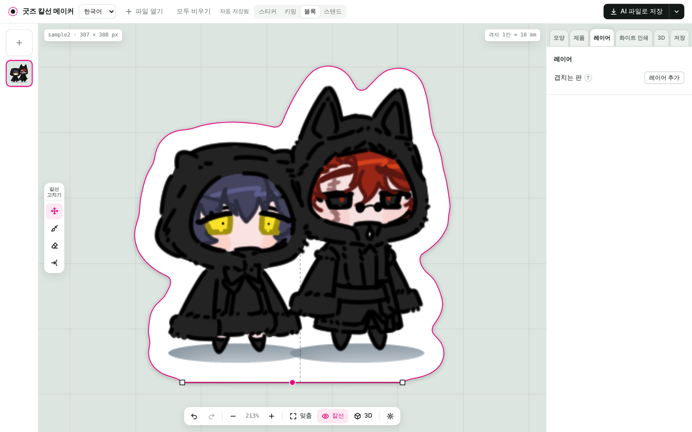

두꺼운 판 한 장으로 세우는 블록입니다. 판을 여러 장 겹쳐 깊이감을 낼 수도 있습니다.

1. 맨 앞에 올 그림을 엽니다. 한 장만으로도 블록이 됩니다.
2. 판을 겹치려면 **레이어** 탭에서 **레이어 추가**로 뒤에 겹칠 그림을 넣습니다.
3. 목록 위쪽이 **맨 앞**, 아래쪽이 **맨 뒤**입니다. 화살표로 순서를 바꿉니다.

- 모든 레이어는 **같은 크기의 캔버스**에 그려 주세요.
- 칼선은 모든 레이어를 합친 모양입니다.
- **제품** 탭에서 외곽 모양(그림대로 · 네모 · 타원 · 원)과 **평평한 바닥**을 정합니다.

> AI 파일은 투명도를 담지 못해 판마다 흰 바탕이 깔립니다. 블록은 **PDF**로 보내는 것을 권장합니다.

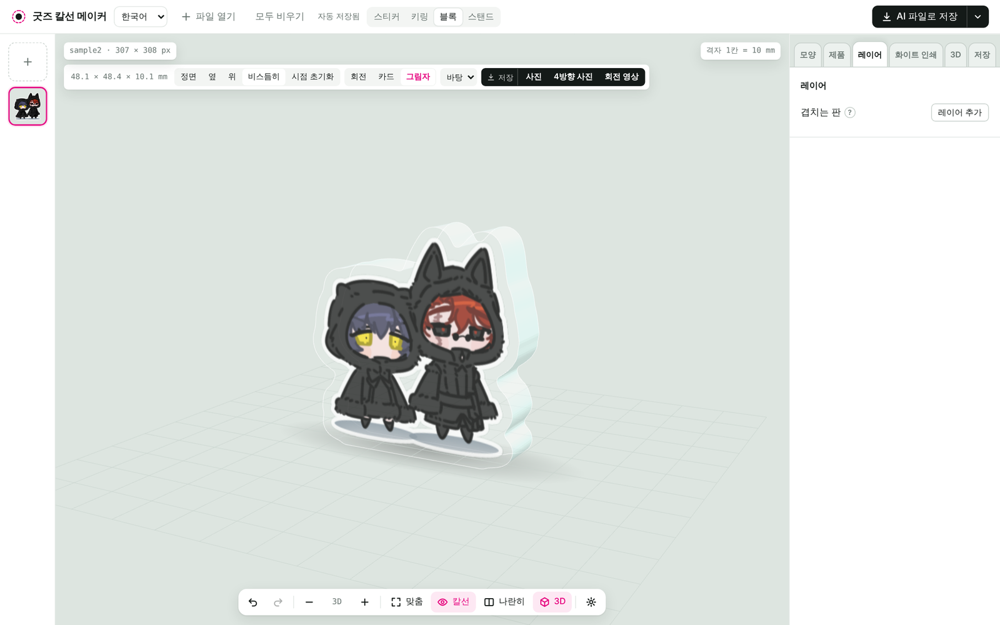

---

## 7. 아크릴 스탠드

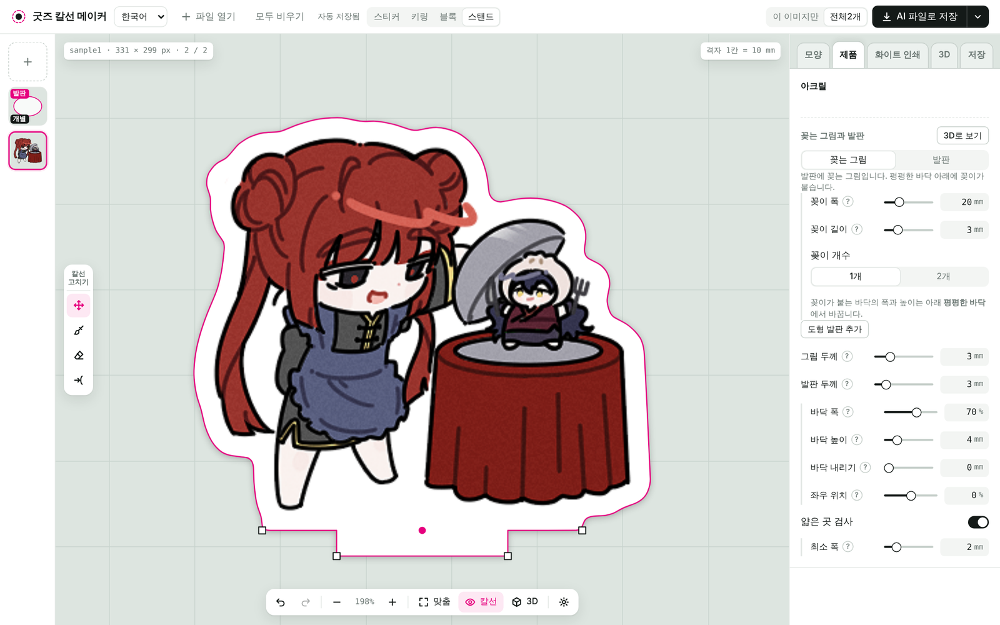

그림을 발판에 꽂아 세우는 스탠드입니다.

1. 그림을 열면 **꽂이**(아래 돌기)와 **발판**이 자동으로 만들어집니다.
2. **제품** 탭에서 꽂이 폭 · 길이 · 개수를 정합니다.
3. 발판 모양을 바꾸려면 **도형 발판 추가**를 쓰거나, 직접 그린 발판 그림을 열고 **발판**으로 지정합니다.
4. 3D에서 꽂힌 그림을 끌면 발판 위 자리가 옮겨집니다.

- 꽂이 길이는 보통 **발판 두께와 같게** 합니다. 꽂이가 더 길면 알려 줍니다.
- 쓰러지기 쉬운 모양이면 경고가 뜹니다. 바닥 폭을 넓히거나 무게중심을 맞춰 보세요.

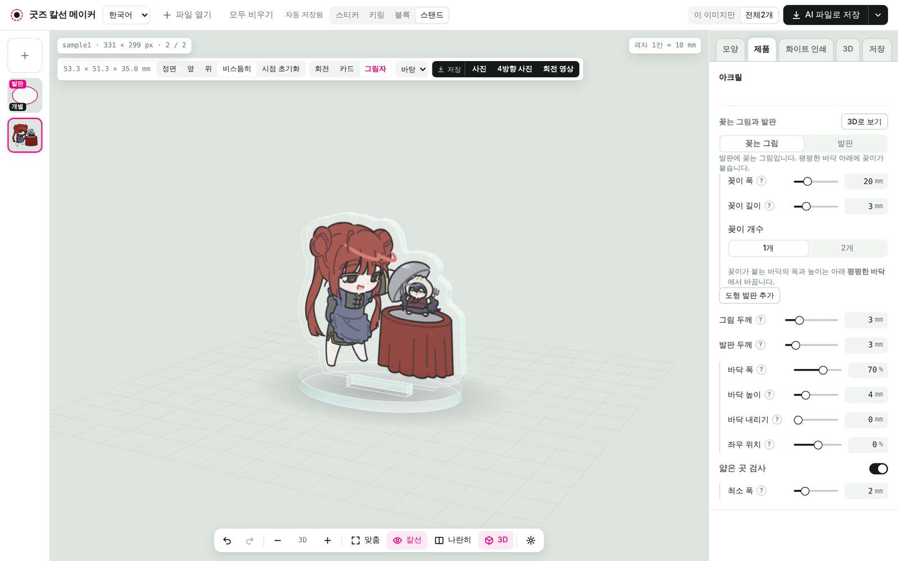

---

## 8. 화이트 인쇄와 뒷면

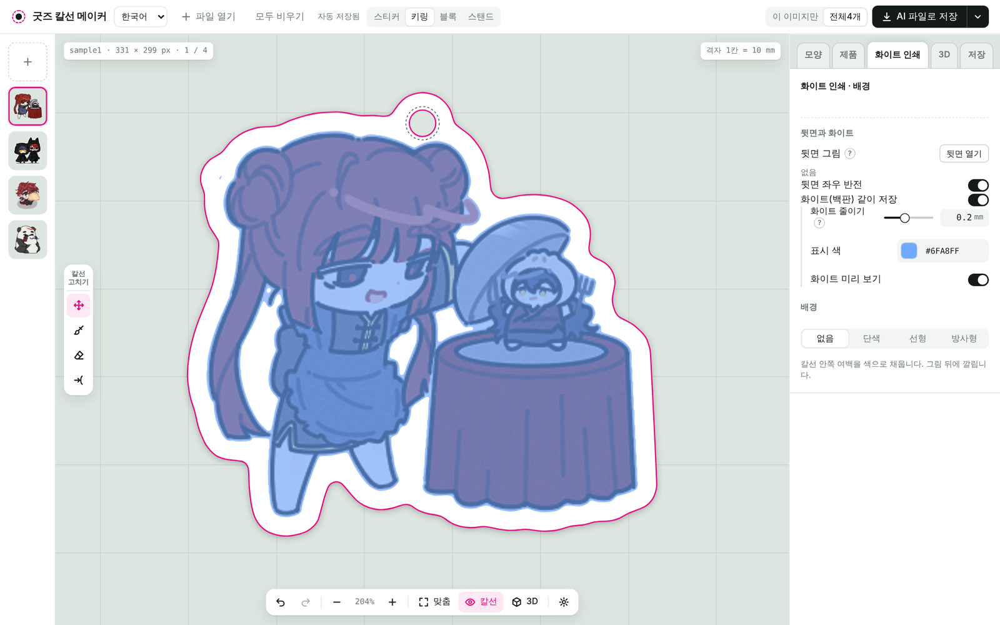

아크릴은 **화이트 인쇄** 탭에서 설정합니다.

1. **화이트(백판) 같이 저장**을 켜면 화이트 레이어가 파일에 들어갑니다.
2. **화이트 미리 보기**를 켜면 화이트가 들어갈 자리를 표시 색으로 보여 줍니다.
3. **화이트 줄이기**: 인쇄가 밀려도 화이트가 삐져나오지 않게 안쪽으로 줄입니다.

**양면 인쇄**
- **뒷면 열기**로 뒷면 그림을 넣습니다. **앞면과 같은 크기**여야 합니다.
- 파일 이름을 **앞면이름_back**으로 해 두면 같이 열 때 자동으로 짝지어집니다.

---

## 9. 3D 미리보기

아크릴 제품은 아래 도구줄의 **3D**를 눌러 완성 모습을 돌려 봅니다.

- **끌기**: 돌리기 / **휠 · 두 손가락**: 확대·축소
- **정면 · 옆 · 위 · 비스듬히**: 정해진 방향으로 봅니다.
- **시점 초기화**: 처음 열었을 때의 각도로 돌아갑니다.
- **카드**: 옆에 신용카드를 세워 실제 크기를 비교합니다.
- **나란히**: 넓은 화면에서 왼쪽 2D, 오른쪽 3D로 같이 봅니다.

**저장** (3D 화면 위쪽)

| 버튼 | 결과 |
|---|---|
| 사진 | 지금 보이는 모습 PNG. 배경을 **투명**으로 고를 수 있습니다 |
| 4방향 사진 | 네 방향을 한 장에 담은 PNG |
| 회전 영상 | 한 바퀴 도는 4초 영상 (MP4, Firefox는 WebM) |

> 3D 꾸미기(고리 종류·색, 두께 등)는 미리보기용입니다. 저장하는 칼선 파일에는 들어가지 않습니다.

---

## 10. 저장하기

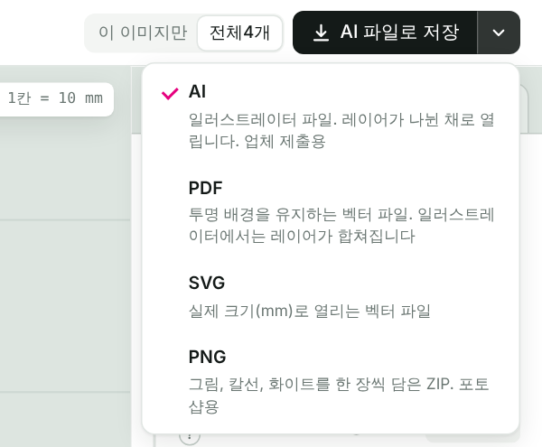

오른쪽 위 저장 버튼의 **⌄**에서 형식을 고릅니다.

| 형식 | 용도 |
|---|---|
| **AI** | 일러스트레이터 파일. 레이어가 나뉜 채로 열립니다. **업체 제출용** |
| **PDF** | 투명 배경을 유지하는 벡터 파일. 일러스트레이터에서는 레이어가 합쳐집니다 |
| **SVG** | 실제 크기(mm)로 열리는 벡터 파일 |
| **PNG** | 그림 · 칼선 · 화이트를 한 장씩 담은 ZIP. 포토샵용 |

- 그림이 여러 장이면 **이 이미지만 / 전체**를 골라 저장합니다.
- 파일 이름은 **저장** 탭에서 바꿉니다.

> 업체마다 칼선·화이트 규격이 다릅니다. 주문 전에 업체 안내를 꼭 확인하세요.

---

## 11. 자주 묻는 것

**칼선이 사각형으로 나와요.**
배경이 있는 그림이라 그렇습니다. 배경을 지운 투명 PNG·WebP로 다시 열어 주세요.

**주황색으로 표시된 곳이 있어요.**
**얇은 곳 검사**가 찾은, 부러지기 쉬운 좁은 부분입니다. 여백을 늘리거나 브러시로 칼선을 넓혀 주세요.

**폰에서도 되나요?**
됩니다. 다만 칼선 고치기처럼 세밀한 작업은 컴퓨터에서 하는 것을 권장합니다.

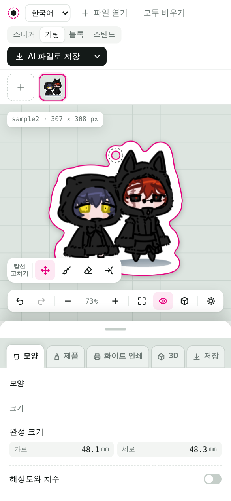

**잘못 바꿨어요.**
`Ctrl`+`Z`나 아래 도구줄의 되돌리기를 누릅니다.

**다른 언어로 쓰고 싶어요.**
왼쪽 위에서 한국어 · English · 日本語 · 中文을 고를 수 있습니다.
